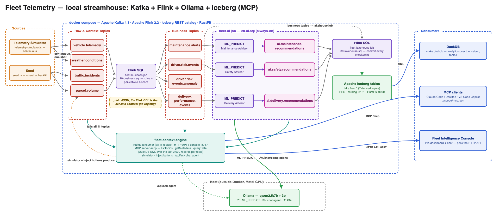
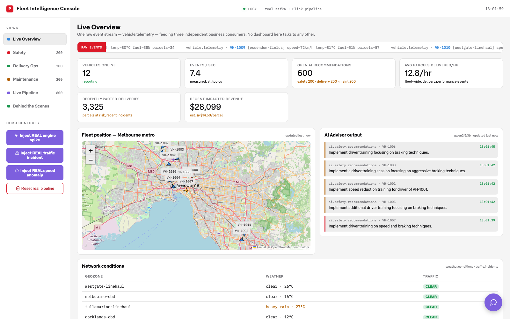

# Fleet Telemetry Demo — a local streamhouse

A delivery fleet in Melbourne, end to end, running entirely on your laptop
with open-source components: vehicle telemetry flows through Apache Kafka,
Apache Flink turns it into business events and — with a small local LLM
called from inside the stream — AI recommendations, and three independent
consumers use the same data: a live dashboard, AI agents over MCP, and
Apache Iceberg tables queried with DuckDB.

(This demo originally ran on Confluent Cloud with Tableflow, RTCE and a
hosted LLM; that version is in git history at `f8c3ee1`.)



Diagram source: [`docs/architecture-diagram.html`](docs/architecture-diagram.html).

## Quickstart

You need **Docker Desktop** (give it 8 GB of memory or more), **make**, and
**Ollama** on the host — natively, not in a container, so the model runs on
the Mac's GPU:

```bash
brew install ollama && brew services start ollama
make model        # ollama pull qwen2.5:7b and qwen2.5:3b (~6.6 GB)
make up           # builds and starts everything
open http://localhost:8787
```

The first `make up` downloads and builds images, so it takes a few minutes.
After that, the console fills within seconds: a one-shot seed backfills
history, and a simulator keeps 12 vehicles reporting every 3 seconds.

`make help` lists everything else; `make down` stops the stack and keeps its
data; `make reset` also deletes the data.



## What's running

| Service | What it is | Address |
|---|---|---|
| `kafka` | Apache Kafka 4.3, single KRaft node, 11 topics (plain JSON, no schema registry) | `localhost:9094` from the host |
| `flink-jobmanager`, `flink-taskmanager` | Apache Flink 2.2 running three SQL jobs: `fleet-business`, `fleet-ai`, `fleet-lakehouse` | Flink UI: http://localhost:8081 |
| `objectstore` | RustFS, S3-compatible storage for the Iceberg tables | console: http://localhost:9001 (`fleet` / `fleet-secret`) |
| `iceberg-rest` | Iceberg REST catalog (the Iceberg project's reference server) | http://localhost:8181 |
| `fleet-app` | `fleet-context-engine`: Kafka consumer, telemetry simulator, HTTP API, the console, the MCP server | http://localhost:8787 (console), `/mcp` (MCP) |
| one-shot | `kafka-init` (topics), `objectstore-init` (bucket), `seed` (backfill), `flink-sql-init` (submits the SQL jobs) | |
| `duckdb` | DuckDB shell with the Iceberg catalog attached (`make duckdb`; not started by `up`) | |
| Ollama (host) | `qwen2.5:7b` for Flink's `ML_PREDICT` recommendations, `qwen2.5:3b` for the chat agent; OpenAI-compatible API | `localhost:11434` |

## The pipeline

**Sources → raw topics.** `telemetry-simulator.js` produces
`vehicle.telemetry` (12 vehicles, every 3 s), `weather.conditions`,
`traffic.incidents` and `parcel.volume`. `seed.js` backfills a backdated
batch on first start.

**Business events** — `local/flink/sql/10-business.sql`, job
`fleet-business`. Rules turn raw signals into one topic per business
domain, each consumed independently: `maintenance.alerts` (engine over
100 °C), `driver.risk.events` (overspeed flag or harsh braking),
`delivery.performance.events` (behind/ahead of schedule). A fourth,
`driver.risk.events.anomaly`, judges each vehicle against its *own* recent
driving: a speed more than 3σ from that vehicle's previous 30 readings,
computed with a Flink OVER window.

**AI recommendations** — `local/flink/sql/20-ai.sql`, job `fleet-ai`.
`CREATE MODEL` with Flink's OpenAI provider, pointed at Ollama, and one
`ML_PREDICT` per domain: every business event gets a one-sentence
recommendation in `ai.*.recommendations`, about a second after the event.
The prompts are built in SQL views; the safety prompt spells out which rule
fired, because a small model given raw field values answers "reduce speed"
to almost everything.

**Lakehouse** — `local/flink/sql/30-lakehouse.sql`, job `fleet-lakehouse`.
The seven derived topics are continuously copied into Iceberg tables
(`lake.fleet.*`), each row keeping its Kafka partition, offset and
timestamp. A new snapshot is committed every Flink checkpoint (30 s).

All table definitions live in `local/flink/sql/00-tables.sql` — with no
schema registry, that DDL *is* the schema contract.

## Using it

**The console** (http://localhost:8787). Live Overview, the three business
dashboards (Safety, Delivery Ops, Maintenance), Live Pipeline (raw
diagnostics), and Behind the Scenes (an animated diagram driven by real
topic arrivals, real Iceberg commits and real agent queries). Demo
controls produce real records: *Inject engine spike* → maintenance alert →
AI recommendation, usually within a second or two; *Inject speed anomaly*
shows the fixed rule and the per-vehicle baseline side by side on the
Safety tab. *Reset real pipeline* deletes every record in every topic.

**Ask the live data** (chat button, bottom right). A local-LLM agent that
answers by running SQL over the live topics through the MCP tools below,
e.g. "Which vehicle is going fastest right now?".

**MCP** at `http://localhost:8787/mcp` (Streamable HTTP, no auth): three
tools — `listTopics`, `getMetadata`, `queryData` (DuckDB SQL over the most
recent 2,000 records of every topic; joins and aggregates work).

```bash
# Claude Code
claude mcp add --transport http fleet http://localhost:8787/mcp
```

VS Code (Copilot) picks up `.vscode/mcp.json` automatically. Claude
Desktop needs a stdio bridge in `claude_desktop_config.json`:
`{"mcpServers": {"fleet": {"command": "npx", "args": ["-y", "mcp-remote", "http://localhost:8787/mcp"]}}}`.

**Flink SQL** — `make sql` opens the Flink SQL client with every topic
defined as a table:

```sql
SELECT vehicle_id, speed_kmh, forecast_speed_kmh FROM `driver.risk.events.anomaly`;
```

To change a job, edit its file in `local/flink/sql/` and redeploy just that
job with `make replace JOB=ai` (or `business`, `lakehouse`). It resumes from
the offsets of its last checkpoint.

**DuckDB on the lakehouse** — `make duckdb`:

```sql
SELECT risk_level, count(*) FROM lake.fleet.driver_risk_events GROUP BY ALL;

-- what the model recommended, over time
SELECT date_trunc('minute', kafka_timestamp) AS minute, recommendation, count(*)
FROM lake.fleet.ai_safety_recommendations GROUP BY ALL ORDER BY minute DESC, 3 DESC;
```

## How this maps to Confluent Cloud

| Here (open source) | Confluent Cloud equivalent |
|---|---|
| Apache Kafka, topics created by `kafka-init` | Kafka cluster; topics created by Flink `CREATE TABLE` |
| Plain JSON; the Flink DDL is the schema | Schema Registry + `json-registry` format |
| Flink SQL client submitting statement sets (`submit-jobs.sh`) | Flink statements (`confluent_flink_statement`) |
| `ML_PREDICT(TABLE …, MODEL …, DESCRIPTOR(…))` → Ollama | `ML_PREDICT('model', …)` → OpenAI / Bedrock connection |
| Per-vehicle z-score in an OVER window | `AI_DETECT_ANOMALIES` |
| Flink → Iceberg (REST catalog + RustFS) → DuckDB | Tableflow → Iceberg → Snowflake |
| MCP server in `fleet-context-engine` (DuckDB over recent records) | Real-Time Context Engine (managed MCP) |

## Configuration

Set these in the environment (or a `.env` file next to `docker-compose.yml`)
before `make up`:

| Variable | Default | |
|---|---|---|
| `APP_PORT` | `8787` | host port for the console/API/MCP |
| `LLM_MODEL` | `qwen2.5:7b` | model for Flink's recommendations |
| `LLM_BASE_URL` | `http://host.docker.internal:11434/v1` | any OpenAI-compatible API |
| `CHAT_MODEL` | `qwen2.5:3b` | model for the chat agent |
| `AUTO_TELEMETRY` | on | set `"false"` in `docker-compose.yml` to stop the simulator |

Changing `LLM_MODEL` or `LLM_BASE_URL` recreates the Flink containers on the
next `make up`; the jobs are resubmitted and resume from their offsets.

## Known limitations

- **Iceberg tables aren't maintained.** Every checkpoint commits a snapshot
  with small files to each of the seven tables, and nothing expires
  snapshots or compacts files, so a demo left running for days keeps
  growing. `make reset` clears it. (Tableflow handles this for you; open-source
  Flink offers it only via its DataStream table-maintenance API.)
- **No Flink HA.** Anything that recreates the jobmanager (including
  rebuilding the Flink image) drops the running jobs until `flink-sql-init`
  runs again — `make up` does that.
- **At-least-once.** A job restart reprocesses up to one checkpoint (30 s)
  of input, so a few duplicate derived events and Iceberg rows are
  expected; `(kafka_partition, kafka_offset)` identifies them in Iceberg.
- **One model server, shared.** Flink's `ML_PREDICT` calls and the chat
  agent both use Ollama. Chat requests are capped (400 tokens, 60 s) so a
  runaway answer can't queue the pipeline's calls behind it.
- **Model choices are trade-offs.** The pipeline needs ~2.8 model calls/s.
  `qwen2.5:7b` handles 4.7/s (0.8 s each, 4 in parallel) and gives more
  concrete advice than 3b, but uses ~60 % of that capacity, so a backlog
  (after Ollama was down, or the Mac slept) drains about twice as slowly as
  with `LLM_MODEL=qwen2.5:3b` (6.9/s). The chat agent stays on 3b: with its
  long tool-calling prompt, 7b skipped the tools and invented vehicles and
  numbers. The agent now refuses any answer not backed by a successful
  query, but small models can still misread a compound question (e.g.
  report the top vehicle's count as the total).
- **The Mac sleeping pauses everything.** The pipeline resumes on wake; for a
  demo, `caffeinate -dims`.

## Troubleshooting

- **No AI recommendations.** Is Ollama up (`curl localhost:11434/api/version`)
  and the model pulled (`ollama list`)? The `fleet-ai` job keeps retrying
  while the model is unreachable and catches up once it's back.
- **Jobs missing in the Flink UI.** `make up` resubmits them; `make status`
  shows what's running.
- **Port 8787 already in use.** `APP_PORT=8788 make up`, or find the process
  with `lsof -i :8787`.
- **Console says SIMULATED.** `fleet-context-engine` is running without
  `KAFKA_BOOTSTRAP` (e.g. plain `npm start`) — see
  [`fleet-context-engine/SETUP.md`](fleet-context-engine/SETUP.md).

## Business-impact metrics (Overview tab)

"Recent impacted deliveries" and "Recent impacted revenue" are recomputed on
every 3 s poll from the current incident window (`/api/traffic-incidents?limit=30`):
for each incident, the parcels onboard every vehicle in that geozone, summed;
revenue is that × **$14.50/parcel** (a placeholder — there's no pricing data)
× a severity weight (high 100 %, medium 60 %, low 35 %). Bounded to the
current window, so the number falls as incidents age out.

## Repository layout

| Path | |
|---|---|
| `docker-compose.yml`, `Makefile` | the whole stack |
| `local/flink/` | Flink image, SQL jobs (`sql/`), `submit-jobs.sh`, `sql-shell.sh` |
| `local/duckdb/` | DuckDB image and the catalog-attach script |
| `fleet-context-engine/` | the Node app — see its [`SETUP.md`](fleet-context-engine/SETUP.md) |
| `fleet-intelligence-console.html`, `fonts/` | the console (served by `fleet-app`) |
| `fleet-intelligence-deck.html` | presentation deck (open in a browser; arrow keys to navigate) |
| `confluent-fleet-eda.skill` | Claude skill with this architecture and its decisions and gotchas — add it to a Claude Project or `~/.claude/skills/` so future sessions start with the context (source: `confluent-fleet-eda/`) |
| `docs/` | architecture diagram and screenshot |
| `PLAN-local-docker.md` | how and why this was moved off Confluent Cloud |
